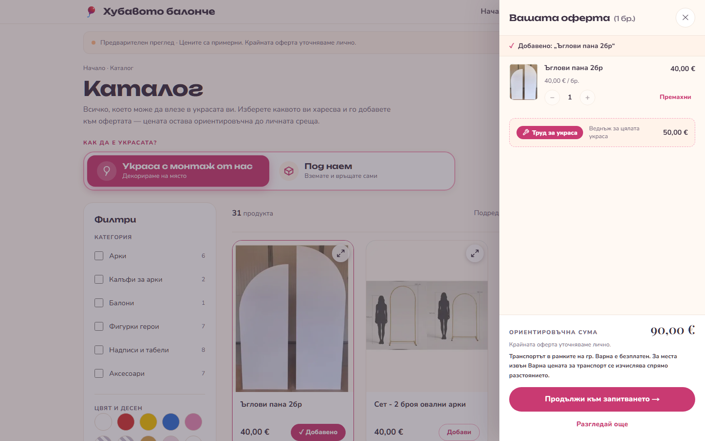
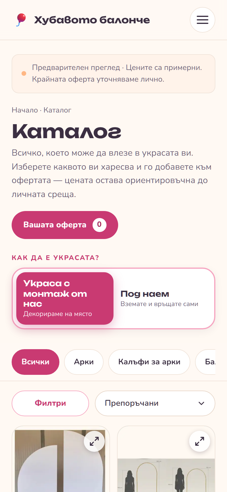

# Хубавото балонче: event decorations in Varna

**Live: [ukrasivarna.com](https://ukrasivarna.com)**

The website of a small business in Varna, Bulgaria, that decorates birthdays, christenings and
weddings with balloon arches, and rents out the arches and props. It is a real site with real
customers. It has two parts:

- **Public site (Bulgarian).** Customers browse the catalog, build a basket, see an *approximate*
  price and send a request. There are no payments and no online booking: a request is a lead, and
  the final price is agreed in person. The owner gets every request by email.
- **Admin.** The owner isn't technical. In the admin she manages products, colours and stock,
  prices, a photo library with a cropper, the homepage carousel, the "inspiration" showcases and
  the gallery, all without touching the database.

| Homepage | Catalog with the basket open | Phone |
| --- | --- | --- |
|  |  |  |

## Stack

- **Next.js 16** (App Router, Server Components, Server Actions) + **TypeScript**
- **Tailwind CSS v4**, with the design tokens in CSS (`@theme`)
- **Supabase**: Postgres with row-level security, Auth for the admin, Storage for photos
- **Resend** (plain REST, no SDK) for the owner's emails
- **Netlify** for hosting, **Playwright** for smoke tests, **GitHub Actions** for lint and build

The dependency list is kept short on purpose: no state library, no CMS, no UI kit.

## What's interesting in the code

- **Availability is computed, not stored.** `reserved_qty()` in [schema.sql](schema.sql) adds up
  the confirmed bookings whose dates overlap. Free stock is `quantity − reserved`, for each
  product and for each colour.
- **RLS is the only guard.** The browser and the server both use the anon key. The public role can
  `INSERT` a booking but never `SELECT` one, so [`submitRequest()`](src/app/actions.ts)
  generates the booking's UUID itself instead of reading it back.
- **The catalog keeps working without the database.** [`getCatalog()`](src/lib/catalog.ts) is the
  only catalog read. When Supabase is missing or the query fails, it falls back to a bundled copy
  of the seed data, so CI builds without any secrets.
- **The basket is `useSyncExternalStore` over localStorage.** It isn't a library and it isn't a
  context. Old saved formats are upgraded when they are read.
- **Privacy by design.** No cookies, no third-party scripts and self-hosted fonts mean the site
  needs no consent banner. [migration-retention.sql](migration-retention.sql) schedules a nightly
  pg_cron job that removes names and phone numbers 12 months after the event.
- **SEO.** Every category, gallery tag and showcase has its own page. The site also has a sitemap
  built from the database, JSON-LD (LocalBusiness, FAQPage), a share image drawn at build time and
  a homepage regenerated every 5 minutes (ISR).

## How it's built: an AI agent pipeline

The site was built by one developer directing a team of AI agents (Claude Code), with small PRs
and real code review:

- A **developer** agent builds one chunk of the plan on its own branch and opens a PR.
- **Security, performance, logic and SEO reviewer** agents each read the diff on their own. They
  have no edit or write tools. Their job is to report, and the developer agent fixes.
- A **lead** session checks every "must fix" finding against the code before posting a single
  review. The developer then gets at most two fix rounds before a human decides.
- Hard rules (no force-push, no pushing to `main` or release branches, no deleting remote refs)
  live in [`.claude/settings.json`](.claude/settings.json) as tool-level denies, not just as
  sentences in a prompt.
- Every release branch goes through a `/release-check` (build, lint, SEO check, smoke tests and
  four reviewers on the full diff, then a go/no-go report) before I merge it into `main`.

### Three PRs worth opening

Out of about 75 PRs, these three show a reviewer catching a real problem and the fix rounds that
followed:

- **[#50: lock the admin down to admins](https://github.com/stiliyan-koev/arches-and-decorations/pull/50)**
  (security). The PR closed "any signed-in account is an admin" for the tables. The reviewer found
  that Storage was still open, so anyone who signed up could overwrite every image. It also found
  that the enrolment step would have promoted every existing account to admin. Round 2 caught the
  same enrolment line still sitting in `schema.sql`.
- **[#32: shared photo library](https://github.com/stiliyan-koev/arches-and-decorations/pull/32)**
  (data loss). New product tiles reused numbered file names and uploaded with `upsert`, which would
  have silently overwritten library photos. The fix switched to random names, and that broke
  photo ordering. Round 2 caught the new bug.
- **[#5: the configurator and rental requests](https://github.com/stiliyan-koev/arches-and-decorations/pull/5)**
  (input validation). The public server action stored `qty` exactly as the caller sent it, so a
  direct call could book a negative or huge quantity and distort availability. The fix validates
  every field of the public request before anything is inserted.

The whole setup, why each piece exists and its known limits are in
**[.claude/README.md](.claude/README.md)**. The agent definitions are in
[.claude/agents/](.claude/agents/) and the playbooks in [.claude/commands/](.claude/commands/).

## Running it locally

```bash
npm install
cp .env.local.example .env.local   # fill in the Supabase URL and anon key
npm run dev                        # http://localhost:3000
```

Without Supabase keys the public pages render from the bundled seed data. To send a request or use
the admin you need a Supabase project: [GETTING-STARTED.md](GETTING-STARTED.md) covers that.

| Command | What it does |
| --- | --- |
| `npm run dev` | Development server |
| `npm run build` | Production build (also type-checks) |
| `npm run lint` | ESLint |
| `npm run seo-check` | Static SEO checks on the source (metadata, canonicals, alt text) |
| `npm run smoke` | Read-only Playwright smoke tests against the production build |

## Docs

- [CLAUDE.md](CLAUDE.md): architecture and conventions, also the agents' main instructions
- [docs/PROGRESS.md](docs/PROGRESS.md): what's done and what's next
- [schema.sql](schema.sql): the schema, RLS policies and availability functions, for a new database
  only. The live database gets changes as `migration-*.sql` files.
- [catalog-and-images.md](catalog-and-images.md): catalog structure and image conventions
